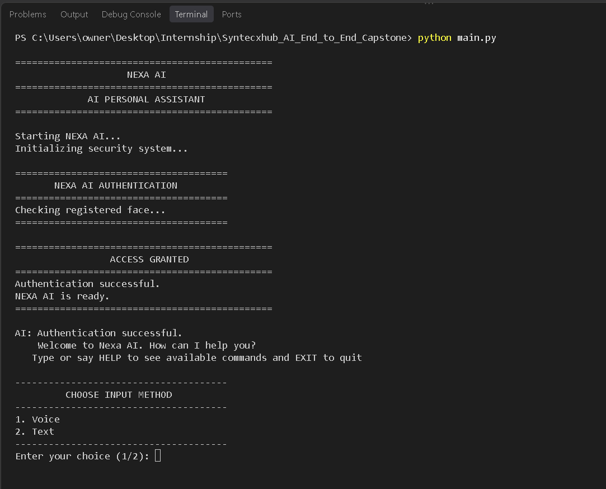
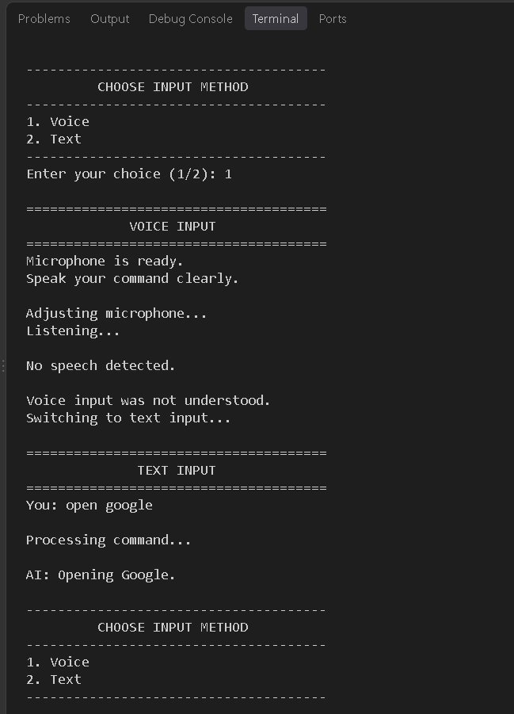
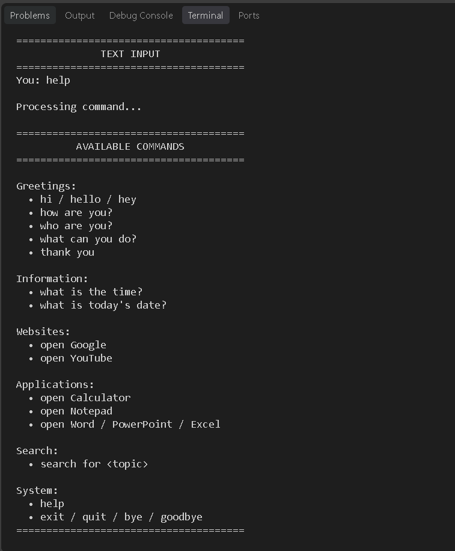
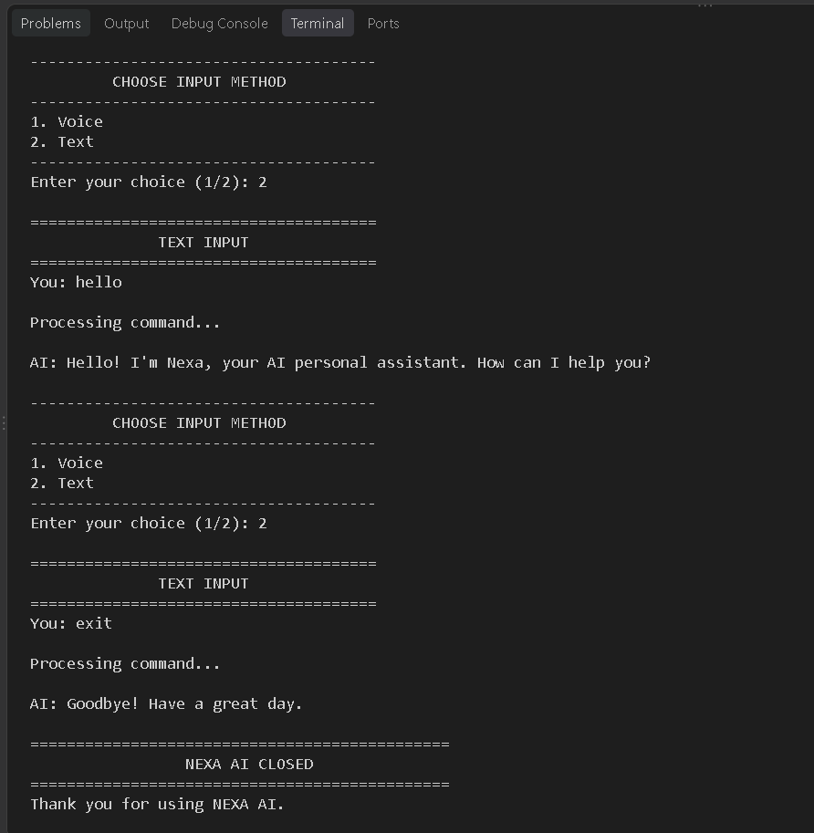

# 🤖 NEXA AI — AI-Powered Personal Assistant

**🚀 Syntecxhub AI Internship | End-to-End AI Capstone Project**

### 🔐 AI-Based Personal Assistant with Face Detection, Voice & Text Commands

NEXA AI is a Python-based personal assistant that combines face recognition, voice interaction, text commands, speech output, and desktop automation in oneapplication. It checks a registered face before allowing the user to interact with the assistant.

This project demonstrates how computer vision, speech recognition, text-to-speech, and Python automation can work together to create an interactive AI assistant.

------------------------------------------------------------------------

## 🎯 Project Objectives

The main objectives of NEXA AI are to:

-   Integrate computer vision and speech technologies into one Python application.
-   Demonstrate face registration and basic face recognition.
-   Support interaction through voice and text.
-   Convert text responses into speech.
-   Automate selected desktop and browser actions.
-   Explore practical applications of AI-related Python libraries.

------------------------------------------------------------------------

## ✨ Features

-   👤 **Face Registration:** Collects and saves face samples during initial setup.
-   🔐 **Face Recognition:** Compares camera images with saved face samples using LBPH         face recognition.
-   🎙️ **Voice Interaction:** Accepts spoken commands through a microphone.
-   ⌨️ **Text Interaction:** Allows commands to be entered using thekeyboard.
-   🔊 **Text-to-Speech:** Reads assistant responses aloud.
-   🕒 **Time and Date:** Provides the current time and date.
-   💻 **Application Launching:** Attempts to open supported desktop applications.
-   🌐 **Web Navigation:** Opens websites such as Google and YouTube.
-   🔎 **Web Search:** Opens Google search results for a supplied query.
-   📖 **Help Menu:** Shows supported commands and usage instructions.
-   💬 **Conversational Responses:** Responds to supported greetings and common questions.
-   🔄 **Text Fallback:** Allows text input when voice recognition does not work.

------------------------------------------------------------------------

## 🛠️ Technologies Used

  Technology             Purpose
  ---------------------- -----------------------------------------------------
  🐍 Python 3.11         Main programming language
  📷 OpenCV              Webcam access, face detection, and image processing
  🔐 OpenCV Contrib      LBPH face-recognition functionality
  🔢 NumPy               Numerical operations and recognition labels
  🎙️ SpeechRecognition   Voice command recognition
  🎧 PyAudio             Microphone input
  🔊 pyttsx3             Text-to-speech responses
  🕒 `datetime`          Getting the current date and time
  🌐 `webbrowser`        Opening websites and search results

------------------------------------------------------------------------

## 📁 Project Structure

```text
NEXA_AI/
├── main.py
├── face_auth.py
├── dialog.py
├── commands.py
├── requirements.txt
├── README.md
├── screenshots/
│   ├── authentication_successful.png
│   ├── voice_input.png
│   ├── help.png
│   └── text_input.png
└── face_data/              # Created during face registration
    ├── face_001.jpg
    ├── face_002.jpg
    └── ...
```

### 📄 File Descriptions

**`main.py` --- Main Application**

The main application file. It handles:

-   Application startup
-   Face-authentication workflow
-   Access-granted and access-denied messages
-   Command input loop
-   Command execution and responses
-   Application termination

**`face_auth.py` --- Face Authentication**

The face-authentication module. It handles:

-   Webcam access and image capture
-   Face registration and sample storage
-   Face detection and recognition
-   Authentication status messages
-   Success and failure screens
-   Webcam resource cleanup

**`dialog.py` --- Input and Speech**

The input and speech module. It handles:

-   Voice command capture
-   Speech-to-text conversion
-   Text input
-   Text-to-speech responses
-   Microphone error handling
-   Text fallback when voice recognition fails

**`commands.py` --- Command Processing**

The command-processing module. It handles:

-   Greeting and conversational commands
-   Time and date queries
-   Opening websites and Google search results
-   Launching supported Windows applications
-   Displaying the help menu
-   Handling exit commands and unknown requests

**`requirements.txt` --- Dependencies**

Lists the Python libraries required to run the project.

**`README.md` --- Project Documentation**

Contains the project overview, features, setup instructions, usage
guide, and future improvements.

**`face_data/` --- Face Data Storage**

Stores the face images collected during registration. This folder is created automatically when face registration is performed. Do not upload personal face images to a public repository.

------------------------------------------------------------------------

## 📦 Requirements

-   Python 3.11 or a compatible Python version
-   A working webcam
-   A working microphone for voice mode
-   Internet access for Google-based speech recognition
-   The Python packages listed below

The `requirements.txt` file should contain:

``` text
opencv-contrib-python==4.11.0.86
numpy
SpeechRecognition
PyAudio
pyttsx3
```

> ⚠️ **Important:** Use `opencv-contrib-python` for LBPH face
> recognition. Do not install `opencv-python` alongside it in the same
> Python environment.

------------------------------------------------------------------------

## ⚙️ Installation and Setup

### 1️⃣ Check Python

Open a terminal and check that Python is installed:

``` bash
python --version
```

### 2️⃣ Open the project folder

Open your terminal in the folder containing `main.py` and
`requirements.txt`. If needed, navigate to the project folder:

``` bash
cd NEXA_AI
```

### 3️⃣ Create and activate a virtual environment (recommended)

``` bash
python -m venv venv
```

On Windows, activate it with:

``` bash
venv\Scripts\activate
```

### 4️⃣ Install dependencies

``` bash
python -m pip install -r requirements.txt
```

### 5️⃣ Run NEXA AI

``` bash
python main.py
```

------------------------------------------------------------------------

## 🖥️ Application Interface

NEXA AI uses a terminal interface and a webcam window.

### 📷 Face Authentication Window

The webcam window can display:

-   Live camera feed
-   Detected face information
-   Authentication status
-   Success or failure feedback
-   A keyboard option to cancel, where supported

### ⌨️ Voice and Text Interaction

After successful authentication, choose an interaction mode:

-   **🎙️ Voice Mode:** Speak a command into the microphone and listen to the response.
-   **⌨️ Text Mode:** Type a command in the terminal and press Enter.

If voice recognition fails, the application may offer text input as a
fallback.

### 🗣️ Assistant Responses

The assistant displays responses in the terminal and uses text-to-speech to speak them aloud.

------------------------------------------------------------------------

## 🚀 How to Use NEXA AI

### 👤 Step 1: Register Your Face

On the first run, the application may ask you to register your face.

-   Look toward the camera.
-   Keep only one face visible.
-   Move your head slightly between captures.
-   Wait for the required 40 face samples to be collected.
-   Press `Q` to cancel registration if supported by the current screen.

The captured samples are saved in the `face_data/` folder.

### 🔐 Step 2: Authenticate

On later runs, NEXA AI loads the saved face samples and compares them with the face captured by the camera. If the comparison meets the configured recognition conditions, the application displays the authentication result.

### 🎙️ Step 3: Choose Voice or Text

-   In voice mode, speak clearly and wait for the assistant to process the command.
-   In text mode, type a supported command and press Enter.

### 💬 Step 4: Try a Supported Command

## 🎯 Supported Commands

  Category                   Example Commands
  -------------------------- ----------------------------------------------
  👋 Greetings               `hi`, `hello`, `hey`
  💬 Conversation            `how are you`, `who are you`
  🤖 Assistant information   `what can you do`
  🕒 Time                    `what is the time`
  📅 Date                    `what is today's date`
  🌐 Websites                `open Google`, `open YouTube`
  💻 Applications            `open Calculator`, `open Notepad`
  📊 Microsoft Office        `open Word`, `open PowerPoint`, `open Excel`
  🔎 Web search              `search for Python programming`
  📖 Help                    `help`
  🚪 Exit                    `exit`, `quit`, `bye`, `goodbye`

The assistant responds to supported commands and provides a fallback response when it does not understand a command. Application-launching commands depend on the relevant application being installed and accessible on the computer.

------------------------------------------------------------------------

## 🎧 Voice Interaction Requirements

For voice mode to work correctly:

-   🎤 Connect a working microphone.
-   🔒 Allow microphone access in Windows settings.
-   🗣️ Speak clearly and reduce background noise.
-   🌐 Keep an internet connection available for Google-based speech
    recognition.

Voice recognition may fail if the microphone is unavailable, speech is unclear, or the network connection is interrupted.

------------------------------------------------------------------------

## 🧠 How It Works

NEXA AI follows this general workflow:

``` text
🚀 Application Starts
        ↓
🎥 Webcam Opens
        ↓
👁️ Face Detection and Recognition
        ↓
🔓 Access Granted if Authentication Succeeds
        ↓
🎙️ Voice or Text Input
        ↓
🧠 Command Processing
        ↓
⚡ Action Execution
        ↓
🗣️ Assistant Response
        ↓
🔄 Wait for the Next Command
        ↓
❌ Exit Application
```

The system uses OpenCV for face-related processing, accepts commands through voice or text, processes supported commands using predefined rules, and responds through text and speech.

------------------------------------------------------------------------

## 📸 Screenshots and Demonstration

### 1. Face Authentication and Access Granted

Demonstrates successful face verification and access to the NEXA AI personal assistant.



### 2. Voice Recognition Fallback

Demonstrates the voice input process and the fallback to text input when speech is not detected or understood.



### 3. Help Menu and Available Commands

Displays the available commands for greetings, information queries, website navigation, application launching, searching, and system operations.



### 4. Text-Based Interaction and Session Management

Demonstrates text-based communication with NEXA AI, including assistant responses and session termination.



---

## 🔮 Future Improvements

-   🔐 Improve face recognition for registered users.
-   🧠 Help the assistant understand natural language better.
-   🎙️ Improve voice recognition accuracy.
-   ⚡ Add more system commands.
-   🌐 Integrate more websites.
-   💬 Make responses more conversational.
-   🔄 Improve error handling.

------------------------------------------------------------------------

## 📌 Project Scope

NEXA AI is an educational prototype that demonstrates how Python libraries can be combined in a personal assistant. Its face-recognition component uses LBPH and should not be treated as secure identity verification. It does not currently include liveness detection, so photographs or replayed videos may potentially bypass the basic recognition process.

------------------------------------------------------------------------

## 👩‍💻 Internship Details

  Category       Details
  -------------- ----------------------------------------------------
  Organization   Syntecxhub
  Program        AI Internship
  Project        NEXA AI --- AI-Powered Personal Assistant
  Task           End-to-End AI Capstone Project
  Language       Python
  Technologies   OpenCV, NumPy, SpeechRecognition, PyAudio, pyttsx3

------------------------------------------------------------------------

## 🏁 Conclusion

NEXA AI demonstrates how face recognition, voice interaction, text-to-speech, and desktop automation can be combined to create an interactive personal assistant. The project provides a foundation for exploring more advanced conversational AI, improved authentication, and
intelligent automation.

------------------------------------------------------------------------

## 👨‍💻 Author

Developed as part of the **Syntecxhub AI Internship**.

------------------------------------------------------------------------

## 📜 License

This project is developed for educational and internship purposes.

------------------------------------------------------------------------

::: {align="center"}
## 🤖 NEXA AI

**Your Personal Assistant, One Command Away ⚡**

✨ Built with Python, OpenCV, Speech Recognition, curiosity, and a
passion for AI! 🤖
:::


